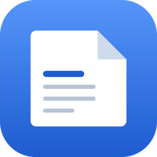
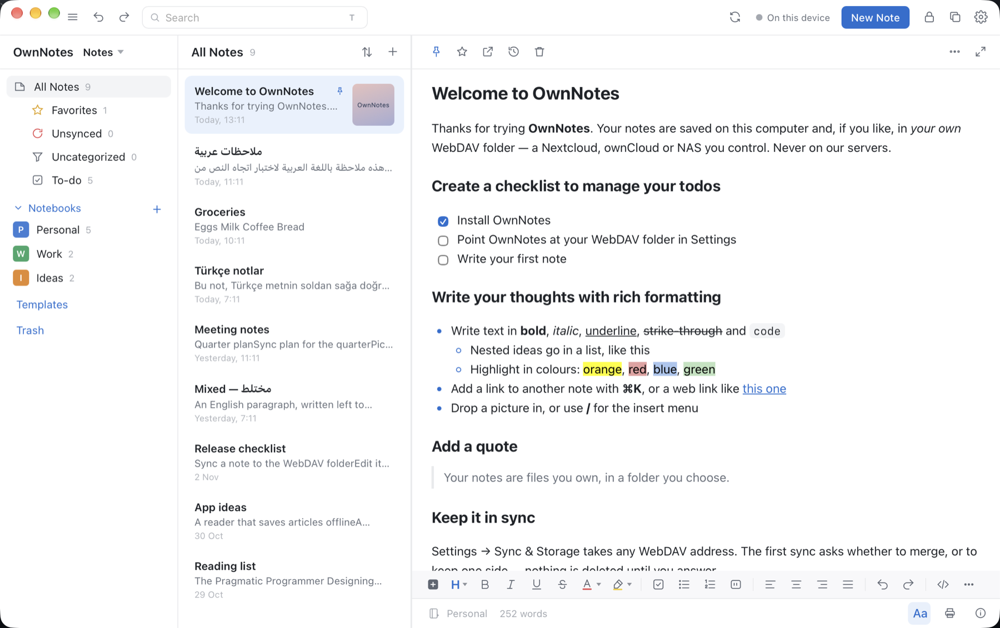

<p align="center">
  
</p>

<h1 align="center">OwnNotes</h1>

<p align="center">
  <b>Notes that are files you own.</b><br/>
  Rich text, right-to-left done properly, and sync through your own WebDAV folder — no account, no vendor, no lock-in.
</p>

<p align="center">
  
  
  
  
  
</p>

---

## ✨ What it is

A notes app built the opposite way round from the cloud ones: your notes are
**plain files in a folder you choose**, and if you want them on more than one
device you point the app at a **WebDAV folder you already have** — Nextcloud,
Koofr, a NAS, anything.

```
notes/Work/note-4183.html      ← readable, syncable, yours
```

## 📸 Screenshots

<p align="center">
  
</p>

<p align="center">
  <sub>Notes, notebooks, spaces and tags on the left; a note with checklists, colours,
  quotes and the format bar on the right.</sub>
</p>

<!-- More screenshots welcome: drop the files in docs/screenshots and uncomment.

<p align="center">
  
  
</p>
-->

## 🌟 Features

### ✍️ Writing
- **Rich text** — bold, italic, underline, strikethrough, `code`, colours and highlights
- **Blocks** — headings *H1–H6*, lists, checklists, quotes, tables, code blocks, dividers
- **Collapsible sections**, **LaTeX** formulas rendered as MathML, **embedded videos**
- **Images and files** — attachments stored beside the note and synced with it
- **Markdown as you type** — `#`, `-`, `1.`, `>`, `- [ ]` convert on space

### 🗂 Organising
- 🗄 **Spaces** — separate universes of notes
- 📚 **Nested notebooks**, and a note can live in **several notebooks at once**
- 🏷 **Tags** — colours, nesting (`work/2026/q1`), rename, delete, drag to reorder
- 📌 **Quick Access**, pinning, favourites
- 🔀 **Drag and drop** notes onto notebooks, tags or the trash — move or add, your choice
- 🧩 **Merge** several notes into one (with undo), **multi-select**, **manual order**
- 🔎 **Unsynced** and **Uncategorized** lists, per-view sorting, saved searches

### 🔒 Privacy
- 🔐 **App lock** and note, notebook and space locks
- 🛡 Locked notes are **encrypted**, not just hidden — AES-256-GCM with a key
  derived from your passcode (PBKDF2-SHA256, 120 000 rounds). What reaches your
  server for a locked note is ciphertext.

### ☁️ Sync
- 🌐 **WebDAV only** — your folder, your credentials
- 🤝 First-sync decision: **merge**, **keep this computer**, or **keep the server**
- 🕓 **Version history** with restore, **scheduled backups**, conflict copies
- ⏱ Automatic sync on change and on an interval, plus a manual button and status

### 🌍 Languages
| | |
|---|---|
| English | left to right |
| **العربية** | **right to left — the whole interface mirrors** |
| Türkçe · Deutsch · Polski · Français · Español | left to right |

Note text follows its own language per paragraph, so one note can hold Arabic
and English and each flows the right way.

### 📥 Import · 📤 Export
- **Import** from Evernote (`.enex`), Markdown, Simplenote (`.json`), Bear
  (`.bear` archives) and Apple Notes
- **Export** to Markdown, HTML, Text, PNG (single or bulk), PDF, or print

## ⌨️ Shortcuts

| | | | |
|---|---|---|---|
| `⌘N` new note | `⌘S` save now | `⌘K` jump to a note | `⌘J` switch space |
| `⌘F` find in note | `⇧⌘F` focus mode | `⌘E` export | `⌘P` print / PDF |
| `⌥⌘P` save as picture | `⇧⌘P` pin | `⇧⌘S` Quick Access | `⌘⌫` trash or restore |

## 🚀 Build

Requires Rust and the [Tauri prerequisites](https://tauri.app/start/prerequisites/).

```bash
git clone https://github.com/baraach/OwnNotes.git
cd OwnNotes
cargo run -p ownnotes-tauri           # development build
```

A distributable app:

```bash
cargo install tauri-cli --version '^2'
cd app-tauri/src-tauri && cargo tauri build
# → target/release/bundle/macos/OwnNotes.app and OwnNotes_1.0.0_*.dmg
```

## 🧪 Tests

```bash
cargo test --workspace
```

Forty tests across the core, plus integration tests that start a real WebDAV
server to exercise attachment sync, and tests for every importer.

## 🗂 Project layout

```
core/                  notes, storage, sync, crypto — no UI at all
app-tauri/src-tauri/   the app: Tauri window, commands, filesystem access
app-tauri/ui/          the interface: HTML, CSS, JavaScript (no build step)
```

## 🧭 How a note is stored

```
notes/Work/note-4183.html
---
id: 4183
title: "Meeting notes"
notebook: 1
space: Notes
pinned: false
starred: false
trashed: false
locked: false
created: 2026-11-04T09:00:00+03:00
updated: 2026-11-04T11:30:00+03:00
---
<p>Quarter plan</p><ul><li>Sync the plan</li></ul>
```

The header makes the file self-describing; the body is ordinary HTML, so it
opens in any browser and diffs sensibly in git.

## 🎨 Style

See [STYLE.md](STYLE.md) — comments explain *why*, errors are sentences in the
user's voice, and anything destructive stops before touching more than it must.

## 📄 License

GPL-3.0. See [LICENSE](LICENSE).
